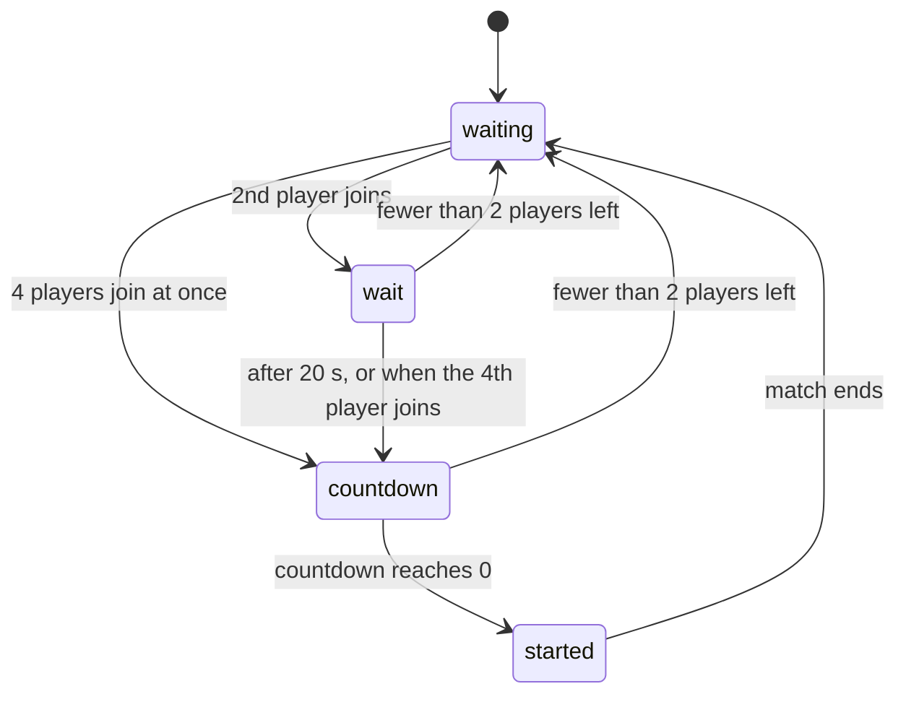
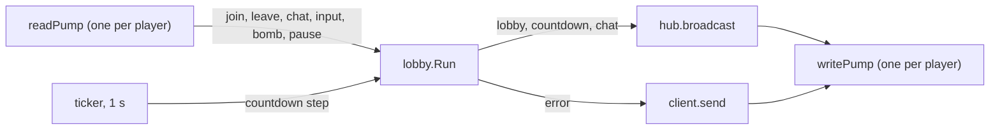
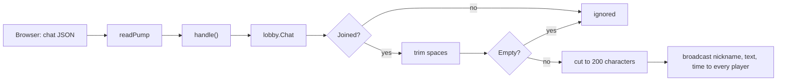
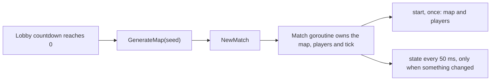

# bomberman-dom

## Overview

A multiplayer Bomberman-style game for 2 to 4 players, built with our own mini-framework (no canvas, no WebGL, no other framework) and a Go server. Players join with a nickname, chat in real time over WebSockets, and battle until one of them is the last one standing.

## Project description

The project is a multiplayer version of the classic Bomberman game. It must be built with the mini-framework created in the earlier mini-framework project.

### Objectives

Build a Bomberman-style game in which several players join and battle until only one is left standing.

### Instructions

A match starts with up to 4 players, and only one can win. Each player starts in a different corner of the map.

The game follows the same principles as the make-your-game project, described below.

#### Features (from make-your-game)

The game must provide:

- At least 60 FPS at all times
- No frame drops
- Proper use of `requestAnimationFrame`
- Measured performance: JavaScript performance is hard to predict, so it must be measured to confirm the code is fast enough. This will be tested.
- A pause menu with:
  - Continue
  - Restart
- A scoreboard showing:
  - A countdown or timer: the time left until the game ends, or the time the game has been running
  - The score: the current score (experience or points)
  - Lives: the number of lives the player has left
- Minimal, but not zero, use of layers, to optimise rendering performance

No frameworks or canvas may be used; the game is built with plain JavaScript, the DOM and HTML only.

#### Animation and controls (from make-your-game)

Animation must move consistently. Smooth animation, without interruptions (known as jank), requires 60 FPS.

The game is played with the keyboard only, and the controls must be smooth: players never need to press a key repeatedly to act. While a key is held down, the action continues; when the key is released, the action stops. Movement triggered by a key must never jank or stutter.

The pause menu must allow players to pause, restart and continue the game at any time. Frames must not drop while the game is paused.

#### Learning outcomes (from make-your-game)

- `requestAnimationFrame`
- The event loop
- FPS
- The DOM
- Jank and stutter in animation
- `transform` and `opacity`
- Rendering tasks:
  - JavaScript
  - Styles
  - Layout
  - Painting
  - Compositing
- Developer tools:
  - Firefox
  - Chrome

#### Good practices

The project must respect the following good practices.

**Code**

- Commenting and documentation
- Consistent indentation
- Avoiding obvious comments
- Code grouping
- A consistent naming scheme:
  - camelCase
  - under_scores
- DRY (Don't Repeat Yourself), also known as DIE (Duplication Is Evil)
- KISS (Keep It Simple)
- YAGNI (You Aren't Gonna Need It)
- Separation of concerns
- Avoiding deep nesting
- Error handling
- Limited line length
- File and folder organisation
- Consistent temporary names
- Separation of code and data
- Code refactoring

**Go**

- Go conventions
- `gofmt`
- `goimports`
- `goimports` compared with `gofmt`

**CSS**

- CSS best practices

**Dockerfile**

- Dockerfile best practices

**Time limit**

- Every program must finish running within 5 minutes.

#### Game performance

Performance is essential. Each frame must take less than 16.7 ms (1000 ms / 60 frames), because both the browser's work and the game's work must fit into every frame.

- `requestAnimationFrame` is used to synchronise changes with the browser.
- Memory is reused where possible, to avoid jank when the garbage collector runs.

Jank is caused by too much work in a frame, for instance:

- JavaScript
- Styles: working out which styles apply to which elements
- Layout: calculating the geometry of the page (for example, recalculating widths and heights)
- Painting: usually needed after layout, and again every time an element animates
- Compositing: putting the layers of the page together at the end

The most costly of these are layout and painting, so they must be avoided. The best way to do this is to use `transform` and `opacity`.

Layout can be avoided with `transform`:

```js
// Avoid: triggers layout and a repaint
box.style.left = `${x * 100}px`

// Prefer: no layout
box.style.transform = `translateX(${x * 100}px)`
```

Painting can be avoided by promoting an element to its own layer:

```css
/* Promotes the element to its own layer, so moving it does not repaint */
#box {
  width: 100px;
  height: 100px;
  /* ... */
  will-change: transform;
}
```

A new layer removes painting, but there is always a trade-off: too many layers increase compositing work and the size of the layer tree. A layer should only be promoted when it is known to be needed. Performance is the key to good animation: "performance is the art of avoiding work".

#### UI and UX

- Follow user interface and user experience best practices.

### Performance, framework and chat

As in make-your-game, performance is one of the most important aspects of the game. The game must:

- Run at 60 FPS or more at all times
- Never drop frames
- Use `requestAnimationFrame` properly
- Have its performance measured, to confirm the code is fast enough

Canvas, WebGL and other frameworks are not allowed. The game is built with the framework from the mini-framework project.

The game includes a chat that lets players talk to each other, built with WebSockets. The chat is the first step of the multiplayer feature.

### Game mechanics

1. **Players**
   - Number of players: 2 to 4
   - Each player has 3 lives. A player who loses all 3 is out.
2. **Map**
   - The map is fixed, so every player sees the whole map at once.
   - There are two kinds of obstacle: blocks, which can be destroyed, and walls, which cannot.
     - Walls are always in the same place; blocks are placed at random on the map. The optional different-maps project is useful here (see below).
     - Players must be able to survive at their starting positions: for example, a player who places a bomb must have room to escape the explosion.
   - Players start in the corners of the map.
3. **Power-ups:** each time a player destroys a block, a random power-up may appear:
   - **Bombs:** increases the number of bombs a player can drop at a time by 1
   - **Flames:** increases the explosion range of the bomb by 1 block in all four directions
   - **Speed:** increases movement speed

#### Optional project: different maps

**Objectives**

This optional project follows the same principles as make-your-game, and requires:

- A tileset used to generate tile maps
- Our own engine to generate tile maps (tile editors are not allowed)
- At least 3 different tile maps
- Each map different from the others

**Instructions**

To store tile images efficiently, all tiles are grouped in a single image (the tileset). Each tile is drawn by selecting its section of that image. This improves both performance and memory use.

Scrolling tile maps can be costly to render, so they need special care. One of the best approaches is to render only the tiles visible to the player, using `opacity` or other methods, although this is sometimes not enough.

A tile map can be represented as a logical grid, which helps with both the display and the game logic. An example tile map data structure:

```js
const map = {
  columns: 5,
  rows: 5,
  size: 25,
  tiles: [
    1, 3, 3, 3, 1,
    1, 1, 1, 1, 1,
    1, 1, 1, 1, 1,
    1, 3, 1, 1, 1,
    1, 3, 1, 2, 1,
  ],
  getTile(col, row) {
    return this.tiles[row * this.columns + col];
  },
};
```

This map object contains:

- `columns`: the number of columns in the grid
- `rows`: the number of rows in the grid
- `size`: the size of the map
- `tiles`: the array holding the grid
- `getTile`: a function that returns the tile at a given position

This is only an example; properties can be added to suit the game.

Learning outcomes:

- Tile maps
- Image manipulation
- Rendering

### Joining a game

When a player opens the game, they are asked for a nickname, which tells players apart. After choosing a nickname, the player is taken to a waiting page with a player counter that goes up to 4. Each time a player joins, the counter increases by 1.

If at least 2 players are waiting and the counter does not reach 4 within 20 seconds, a 10-second countdown starts so players can get ready, and then the game starts. If the counter reaches 4 within 20 seconds, the 10-second countdown starts straight away, and then the game starts.

### Bonus

The following optional features can make the game even better:

- **Solo and co-op mode:** an AI opponent plays against the players. When the AI is defeated, every player involved wins.
- **More power-ups:**
  - **Bomb Push:** throw a bomb after it has been placed
  - **Bomb Pass:** walk through bombs
  - **Block Pass:** walk through blocks (not walls)
  - **Detonator:** choose when a bomb explodes, with a key press
  - **1 Up:** gain an extra life
- **Power-ups released on death:** when a player dies, they drop one of their power-ups. A player with no power-ups drops a random one.
- **Team mode:** 2 versus 2 matches.
- **After-death interaction:** a player who dies comes back as a ghost. A ghost that touches another player comes back to life. A ghost caught in a bomb explosion dies permanently.

### Learning outcomes

- `requestAnimationFrame`
- The event loop
- FPS
- Animation performance and frame rate
- WebSockets
- Synchronisation
- Developer tools:
  - Firefox
  - Chrome

## Using the mini-framework

The game uses only our own mini-framework, copied into `web/framework/`. Every file in `web/src/` imports it from `/framework/index.js`; there is no canvas, no WebGL and no other library. `scripts/check.sh` fails if any forbidden pattern appears (for example `addEventListener`, `innerHTML`, `<canvas`, or an import from a package or URL).

| Function | What it does | Used for |
|---|---|---|
| `h(tag, attrs, children)` | Builds a virtual node | Every view |
| `memo(render, deps)` | Reuses a subtree while `deps` stay the same | The `.entities` layer, so the framework never redraws pooled elements |
| `createStore(state)` | Holds the app state: `getState()`, `setState(object or function)`, `subscribe(select, callback)` | `web/src/store.js` |
| `createApp({ root, store, view, select })` | Renders a view into a root and redraws it only when its selected state changes | The page, chat, board and scoreboard roots in `web/src/main.js` |
| `createRouter({ routes, store })` | Maps `#/`, `#/lobby`, `#/game` and `#/over` to state changes | Page changes |
| `on: { click, input, keydown, ... }` | Events on an element, delegated by the framework | Buttons and inputs |
| `onKey({ Enter: fn })` | Calls a function for one key | Sending a chat message |
| `onGlobal(type, handler)` | A page-wide event, ignored while typing in an input | Game keys |
| `createKeyState()` | Tracks which keys are held | Held arrow keys |
| `createLoop(update)` | A `requestAnimationFrame` loop with the time since the last frame | The game loop |
| `createFpsMeter()` | An on-screen frame rate meter while developing | Performance checks |
| `onMount` / `onUnmount` | Run code when an element is added or removed | Focus, timers, starting the game loop |

A view is a function of the state:

```js
import { h, createApp } from "/framework/index.js";
import { store } from "./store.js";

function Counter(state) {
  return h("p", { class: "counter" }, `${state.players.length} / 4`);
}

createApp({
  root: document.getElementById("app"),
  store,
  view: Counter,
  select: (state) => ({ players: state.players }),
});
```

## Architecture

The browser shows the game; the Go server decides everything. Every rule (movement, collisions, bombs, damage, power-ups, the winner) runs on the server, so every player sees the same match.

```
bomberman-dom/
  server/          Go server: WebSockets, lobby, chat, match, bombs, damage, power-ups, tests
  web/
    framework/     The mini-framework
    src/           The game: store, routes, socket, game engine, views
    styles/        main.css
    assets/        tileset.png: one image with every tile
  scripts/         check.sh
  Dockerfile
```

- **Server** (`server/`): one [gorilla/websocket](https://github.com/gorilla/websocket) connection per player. The **hub** keeps every connection; the **lobby** runs the waiting room and the chat; each **match** runs in its own goroutine at 20 ticks per second.
- **Client** (`web/src/`): `net/socket.js` sends and receives JSON messages; `store.js` holds the state; the views draw it with the mini-framework; `game/` draws the moving parts with element pools.
- **Messages**: every message is `{ "type": ..., "data": ... }`.

| From the browser | From the server |
|---|---|
| `join` (nickname) | `lobby` (players, count), `countdown` (phase, seconds), `error` |
| `chat` (text) | `chat` (nickname, text, time) |
| `input` (held arrows, sequence number) | `start` (map, players), then `state` (only what changed) |
| `bomb`, `detonate` | `pause` (paused, by), `end` (winner, scores) |
| `pause` (pause, continue or restart), `backToStart` | `backToStart` |

### Lobby state machine



### Lobby event loop

The lobby runs in one goroutine and handles one event at a time, so it needs no locks.



### Chat message flow



### Match start



## How to run

You need [Go 1.25](https://go.dev/dl/) or [Docker](https://docs.docker.com/get-docker/), and a browser.

**With Go**

```bash
git clone https://learn.01founders.co/git/nmakridi/bomberman-dom.git
cd bomberman-dom
go run ./server
```

Open <http://localhost:65500> in two or more browser windows (another browser or a private window works too). To use another port: `PORT=8080 go run ./server`.

**With Docker**

```bash
docker build -t bomberman-dom .
docker run --rm -p 65500:65500 bomberman-dom
```

Then open <http://localhost:65500>.

## How to play

**Joining**

1. Create a nickname (1 to 12 characters) and press **Join**.
2. The waiting page shows a player counter (up to 4) and the chat.
3. With 2 or 3 players, the game waits 20 seconds for more, then counts down 10 seconds. With 4 players, the 10-second countdown starts at once.

**Controls (keyboard only)**

| Key | Action |
|---|---|
| Arrow keys | Move (hold to keep moving) |
| Space | Drop a bomb |
| E | Explode your bombs now (with the Detonator) |
| Esc | Pause or continue, for every player |
| R | Restart, while paused |

**Rules**

- Each player starts in a corner with **3 lives**. The corners always have room to escape your first bomb.
- A bomb explodes after **3 seconds**. Its flames reach 1 tile in each direction, stop at walls, destroy blocks and set off other bombs.
- A flame takes **1 life**, from any player, including the one who dropped the bomb. After a hit you are safe for 2 seconds.
- At **0 lives** you are out: you can watch and chat, but not play. The last player in the game wins.
- When a player is out, they drop one of the power-ups they collected, or a random one if they had none.

**Power-ups** (30% of destroyed blocks drop one)

| Power-up | Effect |
|---|---|
| Bombs | One more bomb on the map at once |
| Flames | Flames reach one more tile |
| Speed | Move faster (up to double speed) |
| 1 Up (bonus) | One more life (up to 5) |
| Detonator (bonus) | Press E to explode your bombs at once |

**Score**: +10 for each block your bombs destroy, +100 for each hit on another player, +50 for each power-up. The scores and the winner show when the match ends, and **Back to start** takes everyone on that screen back to the nickname page.

## Game engine and performance

- **One loop**: `web/src/game/loop.js` runs on `requestAnimationFrame` through `createLoop`. Each frame it reads the held keys, predicts the local player, draws players, bombs, flames and power-ups, and stops there. Values that change every frame never go through the store, so the framework does not redraw the page 60 times a second.
- **Element pools** (`game/entities.js`): every player, bomb, flame and power-up element is created once, then hidden and reused, so nothing is created or thrown away during a match (no garbage collection pauses).
- **Transform only**: entities move with `transform: translate3d(...)` in tiles, never with `left` or `top`, so moving does not cause layout or repaint. Only the players keep their own layer (`will-change: transform`); power-ups are layered only while their pulse runs.
- **Prediction** (`game/prediction.js`): your player moves on your screen straight away with the same speed and collision rules as the server. When the server's position arrives, the player is put back there and the key presses of the measured network delay are replayed, so small differences are smoothed and large ones snap.
- **Less network work**: the server sends `state` only when something changed, and only the players that changed.
- **Pause**: the loop keeps running while paused, so no frames drop; it just moves nothing.

**How to measure 60 FPS**

1. Start a match with 2 players and keep only one window in front.
2. In Chrome DevTools (Cmd + Option + I on a Mac), open **Performance**, press record, play for about 20 seconds (move, drop bombs), then stop.
3. Check the **Frames** row: no red or dropped frames, each about 16.7 ms.
4. Open the Command Menu (Cmd + Shift + P), run **Show Rendering**, and tick **Paint flashing**: only moving parts and changed tiles flash, never the whole board.
5. Run **Show Layers**: one layer for the page and one per player.

Our measurement: 60.0 FPS average, slowest frame 17.7 ms, 0 dropped frames, 0 long tasks.

## Map, tiles and design

- **Map generation** (`server/mapgen.go`): the map is 15 by 13 tiles. The border and every tile where both the column and the row are even are walls, always in the same place. Every other tile becomes a block with a 70% chance, from a random seed per match, except the three tiles in each corner where players start.
- **Collision grid** (`server/collision.go`): walls, blocks and bombs block movement. A player can walk off the bomb they just dropped, and slides round a corner when they are up to 0.4 tiles off a corridor. The browser uses the same rules for prediction.
- **Tileset** (`web/assets/tileset.png`): one image with 14 tiles of 48 by 48 pixels in a row: floor, wall, block, bomb, flame, the Bombs, Flames and Speed power-ups, the four players, then the 1 Up and Detonator power-ups. Each tile is a CSS class (`.tile-wall`, `.tile-player-1` and so on) that shows its part of the image with `background-position`.
- **Styles** (`web/styles/main.css`): colours, spacing and sizes are CSS variables. The tile size `--tile` shrinks with the window, so the board always fits. Each player keeps their colour (red, blue, green, yellow) in the lobby, the chat, the scoreboard and on the board.

## Testing

```bash
gofmt -l .
go vet ./...
go test -race ./...
bash scripts/check.sh
```

- `gofmt -l .` and `go vet ./...` print nothing when the Go code is clean.
- `go test -race ./...` runs every server test with Go's race checker: lobby timers and rules, map generation, collisions, movement, bombs, damage, power-ups, pause and restart.
- `scripts/check.sh` checks that `web/src/` uses only the mini-framework.

**Stress test** (4 players join, play and leave, run 20 times in a row):

```bash
time go test ./server -run TestStress -race -count=20 -timeout 5m
```

It passes when the output ends with `ok`, shows no `DATA RACE`, and takes under 5 minutes in total.

## Team

| Name | Gitea | Role | Skills |
|---|---|---|---|
| Niko | nmakridi | Server Network Engineer | Back-End, Full-Stack, code review |
| Sabri | ssuleiman | Client Network Engineer | Front-End, Network |
| Claudia | cwidger | Frontend & QA Engineer | Front-End, QA |
| Amal | aosman | Game System Designer | UI/UX, Systems |

**Who did what**

- **Niko**: project set-up; the WebSocket hub, lobby and chat relay; the match, movement, bombs, damage, scoring and power-ups, including the bonus power-ups and the drop on death; pause, continue and restart; reviewing and merging every pull request.
- **Sabri**: the WebSocket client; element pools and transform-only rendering; client-side prediction; drawing bombs and flames; the performance check.
- **Claudia**: the check script; the client store and routes; the tileset and base styles; the nickname and waiting pages; the chat panel; drawing players; the game over screen; server tests and the stress test.
- **Amal**: map generation and the collision grid; the Dockerfile; the WebSocket message dispatch; drawing the board and power-ups; page styles and the responsive layout; the scoreboard.
